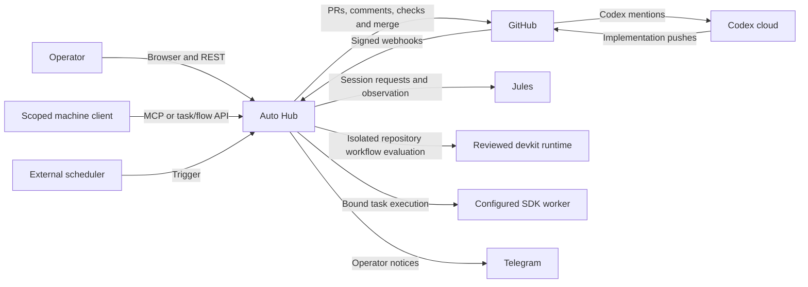

# [ARCH-03-system-context] System scope and context

## System boundary

Auto Hub consists of a FastAPI application, a browser SPA and a standalone SDK.
The application coordinates development work and retains its execution evidence.
It does not host the coding agent or replace the target repository's CI.

## Actors and ownership

| Actor or system | Interaction | Authority boundary |
| --- | --- | --- |
| Operator | Configure projects; submit, inspect and control work | Human authentication and each operation's approval subject remain distinct |
| Machine client | Discover/call MCP tools or submit SDK contracts | Registered machine identity and required scopes bound each call |
| External scheduler | Trigger due scheduler work | A trigger requests dispatch; it does not certify delivery success |
| GitHub | Repository data, PRs, CI, webhooks and merge | Current PR revision and actual merge state remain authoritative |
| Coding provider | Implement changes or return a report | A reply alone is not proof of a pushed implementation |
| devkit runtime | Evaluate repository-native workflow and decision artifacts | Workflow evidence does not replace Hub merge authorization |
| SDK worker | Execute an admitted release's configured target | Registering a release does not deploy worker code |
| Telegram | Carry outbound notices | Notification delivery grants no execution or approval authority |

Product contracts are `CAP-PR-pull-request-delivery`,
`CAP-WORK-work-plan-execution`, `CAP-SDD-native-delivery` and
`CAP-SDK-task-flow-execution`. Access contracts are
`CAP-ACCESS-authentication-authorization` and `CAP-MCP-tool-access`.

## Code anchors and evidence

- [Application composition](../../modules/hub/app/main.py) creates REST, MCP and SPA surfaces.
- [Router composition](../../modules/hub/app/router.py) separates signed-in,
  scheduler, machine-authenticated flow and webhook paths.
- [App integration tests](../../modules/hub/tests/integration/test_main.py) cover
  API/UI separation and protected MCP routes ahead of the SPA fallback.
- [MCP integration tests](../../modules/hub/tests/integration/mcp/test_mcp.py)
  cover endpoint discovery and scoped calls.

These are implementation and enforcing-test anchors. Deployment evidence remains
in [delivery status](../operations/deployment-status.md).
