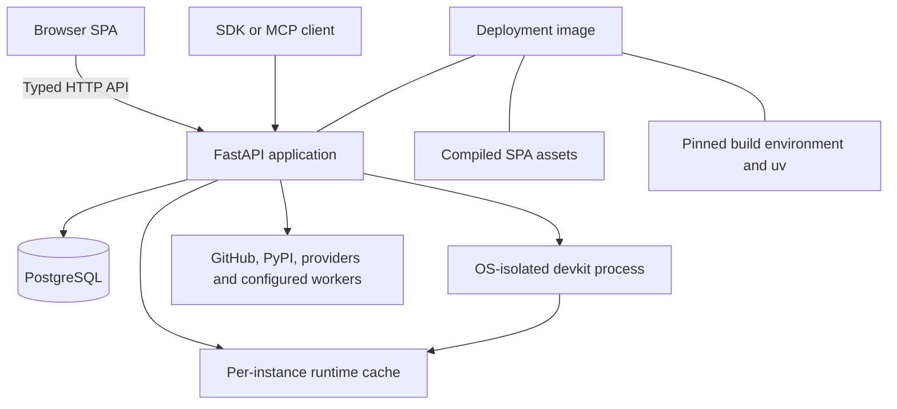

# [ARCH-05-1-containers] Containers and code ownership

## Runtime building blocks

The diagram separates logical runtime blocks. The standard image serves both the
API and compiled SPA. It contains no devkit runtime: each evaluation installs the
runtime its repository's `uv.lock` pins into the per-instance cache, using the
image's `uv` and pinned build environment (`ADR-repository-locked-runtime`).

| Block | Code or configuration | Owned responsibility |
| --- | --- | --- |
| Backend | `modules/hub/app` | HTTP/MCP adapters, execution coordination, durable state and provider integrations |
| SPA | `modules/hub-ui/src` | Operator views, browser session state and typed API consumption |
| Database | `modules/hub/migrations`, `app/common/database_schema.py` | Application records, leases, revision fences and migration-managed structure |
| SDD process | `app/features/project_management/sdd` | Disposable repository evaluation with the lock-derived runtime identity |
| Runtime cache | `AUTOHUB_SDD_CACHE`, `config/sdd-build` | Content-addressed lock-derived runtimes per instance; the build environment's lock is part of each identity |
| Standalone SDK | `packages/sdk/src/autohub_sdk` | Local declarations, manifests and typed remote client contracts |

## Backend decomposition

`ARCH-05-2-components` owns the internal feature responsibilities, provider ports
and registries. The task registry is exposed from `app/features/execution/tasks`;
startup invokes its autodiscovery. `app/features/__init__.py` re-exports this
entrypoint rather than introducing another task implementation.

## Dependency direction

The backend consumes `autohub-sdk`; the SDK does not import the backend or its
database. The SDK manifest declares Pydantic as its runtime dependency. Repository
SDD runtimes are installed separately from the backend environment, from only the
locked dependency group that declares `devkit-spec`; Hub never installs a target
repository's whole dependency set. `config/sdd-runtime` is a seed manifest for
tests and local development, not a serving runtime.

The shared devkit-viewer component renders documents through a Hub-provided
authenticated repository data source. Its source receipt and rebuild procedure
remain in `modules/hub-ui/vendor/devkit-viewer.md`; product behavior belongs in
`CAP-DOC-repository-viewer`.

The frontend consumes generated declarations under `src/lib/api/generated` and
uses the shared API/session client. Code-generation details remain in the
[UI guide](../../modules/hub-ui/README.md).

## Code anchors and checks

- [Backend manifest](../../modules/hub/pyproject.toml) and
  [SDK manifest](../../packages/sdk/pyproject.toml) define dependency ownership.
- [Task entrypoint](../../modules/hub/app/features/execution/tasks/__init__.py)
  and [startup](../../modules/hub/app/main.py) define registration and lifecycle.
- [SDK tests](../../packages/sdk/tests) exercise declarations and client contracts.
- [Generated API freshness script](../../scripts/gen-ui-api.sh) backs `just check-ui-api`.

Structural constraints and their enforcement belong in `ARCH-02-constraints`.
