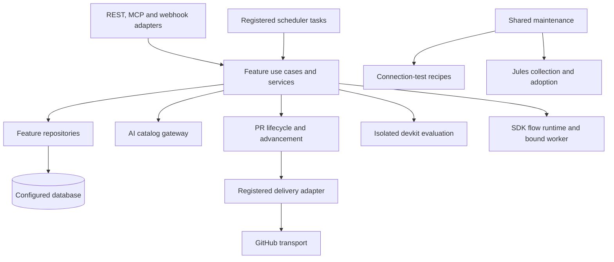

# [ARCH-05-2-components] Backend components and extension boundaries

## Backend white box

`ARCH-05-1-containers` defines the deployable/runtime building blocks. This view
zooms into the backend and its client-facing integration points.

The diagram shows responsibility/delegation relationships rather than an
exhaustive import graph. Existing feature handlers can use a service directly;
`ARCH-02-constraints` names the narrower mechanically checked import boundaries.

## Components and owners

| Component | Base directory | Modules within that base | Contract owner |
| --- | --- | --- | --- |
| Project/connector configuration | `configuration/connectors/`, `project_management/projects/` | API, services, repositories and onboarding | `CAP-PROJ-project-connections` |
| PR coordination | `project_management/pipeline_runs/usecases/` | `lifecycle.py`, `advancement.py`, `progress.py`, `ci.py`, `control.py` | `CAP-PR-pull-request-delivery` |
| Operator interactions | `project_management/pipeline_runs/` | `usecases/interactions.py`, `api/interactions.py`, `interaction_service.py`, `interaction_repo.py` | `CAP-PR-operator-decisions` |
| PR observation | `project_management/pipelines/` | `github.py`, `services.py` | `CAP-PR-ci-observation` |
| PR delivery transport | `project_management/pipeline_runs/adapters/` | `base.py`, `registry.py`, `codex_github_mention.py` | `CAP-PR-agent-dispatch` |
| Webhook intake and continuation | `project_management/github_webhooks/` | `api.py`, `usecases.py`, `repos.py`, `tasks.py` | `CAP-PR-webhook-advancement` |
| Pre-PR admission | `project_management/work_plans/` | Admission, preparation, control and execution repositories | `CAP-WORK-work-plan-execution` |
| Account-wide admission | `ai_catalogs/` | `services.py`, `repos.py`, `policies/` | `CAP-AGENT-catalog-admission` |
| Provider sessions | `execution/tasks/domains/jules/`, `ai_catalogs/providers/` | Session orchestration and Jules HTTP client | `CAP-AGENT-provider-sessions` |
| Diagnostic coordination | `project_management/connection_tests/` | `usecases.py`, `services.py`, `repos.py`, `configuration.py` | `CAP-CONN-connection-verification` |
| Diagnostic resources/proof | `project_management/connection_tests/` | `github.py`, `ownership.py`, `guards.py` | `CAP-CONN-connection-verification` |
| Native SDD | `project_management/sdd/` | Activity, runtime, control and publication modules | `CAP-SDD-native-delivery`, `CAP-SDD-runtime-isolation`, `CAP-SDD-workflow-control` |
| SDK host | `execution/flows/` | API, services, runtime, adapters and bridge | `CAP-SDK-task-flow-execution`, `CAP-SDK-existing-pr-bridge` |
| Dispatch/maintenance | `execution/dispatchers/`, `execution/tasks/domains/maintenance/` | Dispatch orchestration and shared housekeeping | `CAP-EXEC-scheduling-maintenance` |
| Notices | `notifications/`, `execution/dispatchers/usecases/` | Notification service and `housekeeping.py` | `CAP-NOTIFY-operator-notifications` |

Base directories are relative to `modules/hub/app/features`; filenames in the
next column are relative to their row's base. Authentication and MCP composition
live outside this table at `app/auth.py`, `app/main.py` and `app/mcp`; their feature
guarantees belong in the access and MCP capabilities.

## Provider ports and registries

Quota policy and delivery transport are separate extension axes. The policy
registry in `ai_catalogs/policies/registry.py` selects the account's admission
model. `project_management/pipeline_runs/adapters/registry.py` selects a supported PR delivery
adapter. Adding a provider kind does not itself implement PR delivery.

Registered Jules tasks use the same catalog gateway and provider client as other
Jules coordination. `ai_catalogs/providers/jules.py` owns the HTTP API boundary;
`execution/tasks/domains/jules/service.py` owns tracked session orchestration and
PR adoption. Agent schedule services derive and own their `ScheduleConfig`
entries; they are not a second execution engine.

Connection tests have a separate recipe registry under
`project_management/connection_tests/adapters`. The coordinator owns leases, configuration identity
and persisted transitions; recipes own preparation, dispatch, observation and
cleanup. Common GitHub resource/proof helpers prevent a recipe's uncertain output
from being treated as a normal development PR.

Shared maintenance discovers pending diagnostic/session work independently of
the schedules that originally started it. It delegates domain operations rather
than copying provider logic. Exact fairness, retention and retry rules remain in
the owning capabilities.

## Frontend boundaries

The UI policy registry is
`modules/hub-ui/src/lib/features/configuration/ai-catalogs/catalog-kinds.ts`.
Catalog capability flags drive connector, delivery and session controls.
Connection-test UI reads serialized recipe options; it does not implement the
backend's provider state machine. The shared devkit-viewer component renders
repository documents through Hub's authenticated data source.

[Provider extension instructions](../development/provider-extensions.md) own the
contributor steps and tests for a new kind/adapter/recipe. These registry and
component boundaries are source-defined; review is required for responsibility
changes beyond the import checks named in `ARCH-02-constraints`.
