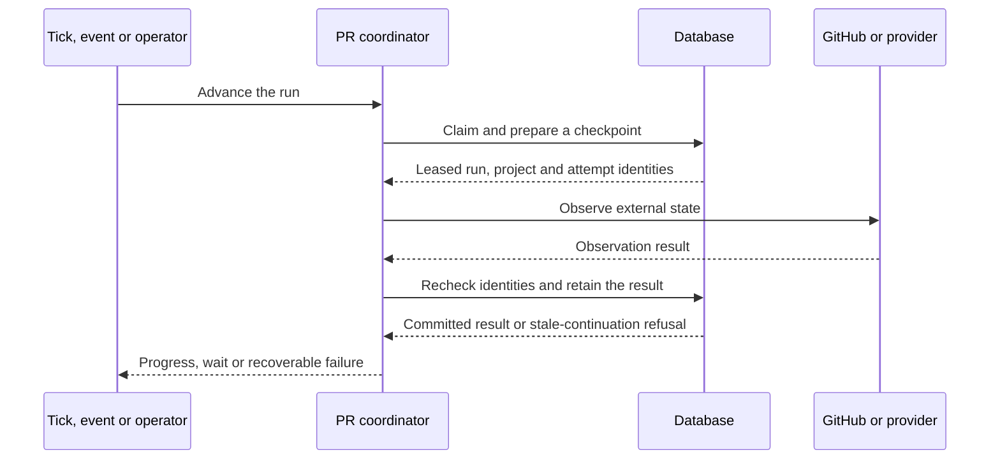

# [ARCH-06-execution] Execution and recovery sequences

## Execution paths

| Path | Durable records | Runtime delegation | Contract owner |
| --- | --- | --- | --- |
| Scheduled task | `ScheduleConfig`, `ScheduleJob` | External trigger claims due work and invokes its registered handler | `CAP-EXEC-scheduling-maintenance` |
| PR delivery | `PipelineRun`, attempts, deliveries and replies | Ticks/events/operator calls enter shared bounded advancement | `CAP-PR-pull-request-delivery` |
| Work Plan | `WorkPlan`, `WorkItem`, typed recovery records/events | Admission creates or attaches a PR, then hands it to the existing PR owner | `CAP-WORK-work-plan-execution` |
| Repository SDD activity | Descriptive PR activity intent and recoverable claim | Working agent owns repository workflow; ordinary PR owner advances delivery | `CAP-SDD-native-delivery` |
| SDK task/flow | `sdk_flow_*` releases/runs/steps/attempts/commands | Maintenance advances an immutable admitted release through configured targets | `CAP-SDK-task-flow-execution` |
| Connection diagnostic | Test record, ownership and cleanup evidence | A claimed recipe step prepares, dispatches, observes or cleans up diagnostic work | `CAP-CONN-connection-verification` |

Completing a scheduler invocation does not imply that a delegated PR or SDK flow
has completed. Shared maintenance delegates pending domain work rather than
substituting a second execution owner.

## Ordinary PR observation

The observation transaction ends before external I/O. A later write rechecks the
checkpoint in a fresh transaction. If the result enables another ready step,
advancement can continue within its existing invocation budget. Delivery or an
actual wait returns control to a later trigger. CI interpretation and provider
transport are delegated to `CAP-PR-ci-observation` and `CAP-PR-agent-dispatch`.

Webhook acknowledgement precedes completion of this path. The stored delivery
can be processed through the configured queue or bounded recovery;
`CAP-PR-webhook-advancement` owns that intake/continuation boundary.

## Work Item recovery

`ADR-work-item-recovery-lineage` retains the original Item and linked Run. `WorkItemRecovery` stores project-local request uniqueness, actor/reason, normalized command, accepted revisions, immutable prior outcome and mutable progress. `WorkItemRecoveryEvent` appends ordered outcome evidence. A partial unique index admits one pending recovery per Item. Recovery snapshots retain stable execution identities after eligible Run pruning; legacy Items receive no synthetic recovery rows.

Recovery MUST commit its intent and lease generation before remote I/O, and recheck Plan/Run revisions, Item lease token/expiry and recovery generation before applying observations. Check: `test_expired_recovery_observation_cannot_activate`, control-during-I/O regressions and PostgreSQL recovery races in the Work Plan integration suite. Source: `modules/hub/app/features/project_management/work_plans/recovery_tick.py`.

Request acceptance and terminal recovery apply Project → Plan → Run → Item locks; terminal admission then locks the catalog. Ordinary preparation admission uses Project → Plan → catalog and never locks a Run. Existing delivery locks Run before catalog. Observation/retention uses Run → Item and never acquires Project/Plan afterward. Item-only lease writes acquire no parent afterward. These orders MUST remain compatible when both owners operate on one Item. Check: PostgreSQL Work Plan/PR integration suites, including ordinary enrollment winning during recovery I/O; review also checks acquisition order.

The recovery worker releases DB locks for PR/ref/comment reads. Pending records stay outside ordinary Item observation; the recovery due queue filters leases/holds before its bounded limit. Once preparation is admitted, the existing preparer owns it. Historical started-work metadata remains set while waiting, preserving the specification edit fence. Terminal activation and its durable intent commit together; active-owner uniqueness prevents a losing recovery from dispatching. The existing PR owner then controls delivery, current-head CI and final merge. A recovery-confirmed last-Item merge invokes ordinary Plan completion and mirror reflection in the same transaction.

## Repository activity publication

Planning and Development are explicit activity intent over ordinary PR delivery.
Hub reserves the exact unit/activity/request before GitHub ref and Draft PR
publication. It records candidate artifacts and recovers the same owner after a
lost response. It does not author repository state or evaluate a devkit stage.

Optimistic snapshots carry `execution_version: 2` and `provider: repository-agent`.
Repository setup, workflow gates and correctness belong to its working agent.
Questions around pushes are processed before CI/merge continuation; a saved answer
alone changes no merge authority. `CAP-SDD-native-delivery` and
`CAP-PR-operator-decisions` own these contracts.

## SDK dispatch and PR handoff

Release registration and run admission retain the definition/binding snapshot.
A maintenance step then commits attempt intent, calls the bound worker outside
the database transaction and fences the returned result. Recovery inspects the
same attempt before deciding whether another submission is permitted.

The built-in SDD/PR bridge namespaces are retired. Undispatched and unreceipted
legacy work settles terminally; an exact receipt-backed delivery may observe its
existing PR owner without repeating resume. `CAP-SDK-existing-pr-bridge` owns this
retirement boundary. Generic SDK flow dispatch remains independent.

## Diagnostic completion and housekeeping

A diagnostic step records its verification result separately from resource
cleanup. Shared maintenance can continue unresolved cleanup after the initiating
schedule or page is gone. The diagnostic coordinator and provider recipe remain
responsible for ownership proof and current step identity throughout that work.

Notice delivery reports a retained outcome and has its own acknowledgement;
it does not change the work's authorization. Rate limits, connector rejection
and provider admission holds return control to their owning path's retry/wait
policy. `CAP-NOTIFY-operator-notifications` owns the outbound report, while the
execution capability owns the actual next action.

Implementation anchors include
[PR progress](../../modules/hub/app/features/project_management/pipeline_runs/usecases/progress.py),
[activity publication](../../modules/hub/app/features/project_management/sdd/activities.py),
[SDK runtime](../../modules/hub/app/features/execution/flows/runtime.py) and
[connection coordination](../../modules/hub/app/features/project_management/connection_tests/services.py).
`ARCH-10-quality-requirements` connects these sequences to measurable regression
scenarios; [deployment status](../operations/deployment-status.md) retains live evidence.

## Legacy execution retirement

Legacy native snapshots and retained batch/claim/decision tables remain historical.
The data migration cancels nonterminal old Runs, revokes leases, settles local
active attempts and stops old batches. It preserves immutable requests, selections,
receipts, exact remote artifacts and uncertainty. A downgrade does not reactivate
retired authority.

Hub MUST refuse implicit conversion or resume of old native work and preserve an
uncertain reservation until explicit project-scoped reconciliation acknowledges
the exact retained checkpoint. Check: retirement migration and claim reconciliation
tests; source discriminator in `project_management/sdd/execution.py`.

The migration performs no GitHub mutation and cannot cancel previously dispatched
external agent work. Explicit reconciliation releases only the selected reservation;
it grants no resume, replacement start or merge authority. New starts retain their
own request identity and ordinary active-PR exclusivity.

## Work Item replacement evidence

`ReplacementLink`, `ReplacementAcceptance`, `ReplacementEvent`, `ReplacementReceipt` and per-original `ReplacementEvidence` belong to the Work Plan owner. Replacement evidence structure MUST retain immutable merge snapshots and append-only consumption events under Project ownership with admission. The original Item, Plan outcomes and PR owner remain independent. Check: `test_exact_edge_release_consumption_and_replay`, PostgreSQL admission/withdrawal/control/recovery barriers and `test_activity_failure_rolls_back_acceptance` in `test_replacements.py`. Decision: `ADR-work-item-replacement-evidence`.

Mutation locks use Project, deterministic Plans, deterministic Runs, deterministic Items, then evidence. Existing admission retains Project → Plan → catalog and commits consumed evidence with its conditional Item lease/admission write; no Run lock is acquired afterward. Project serialization prevents competing evidence/recovery/control owners from interleaving. Check: PostgreSQL barrier tests; acquisition order also receives code review.

Evidence tables reference retained Plan/Item lifetimes and preserve replacement snapshots after detailed Run retirement. Historical requests are actor/path/payload-bound and replay before current revision checks. The HTTP adapter exposes feature-local refusal codes inside the existing detail envelope; the global error handler remains independent. Check: retained/pruning, replay and migration roundtrip integration tests.

## Decision notification maintenance boundary

`DecisionSubscription`, `DecisionNotice`, `DecisionNoticeAttempt`, `DecisionNoticeRequest` and the queue cursor belong to Notifications. Shared maintenance MUST run notification collection after its existing execution owners and bound the notification pass to45 seconds. Each pass rotates at most four channels, scans at most100 persisted discovery entries per channel and admits at most one message per channel. Check: Review only for notification ordering, bound and cursor constants in `decision_worker.py` and maintenance `task.py`; existing maintenance regression tests cover the preceding owners.

Admission MUST serialize through the Notification channel before subscription and attempt state. Network delivery follows durable admission outside the database transaction; outcome persistence checks the exact token, state and60-second lease. Expiry preserves unknown rather than repeating transport. PostgreSQL admission and late-result tests in `modules/hub/tests/integration/features/notifications/test_decision_notices.py` enforce this fence. Per-channel exceptions remain isolated from existing work; a persisted cursor advances fairness across passes. The contract is bounded maintenance work, not a wall-clock delivery guarantee.

The migration freezes its schema definitions. Decision generation tombstones and immutable command receipts survive detailed attempt compaction; deletion of the owning channel cascades notice evidence. Check: `modules/hub/tests/integration/migrations/test_decision_notices.py`. `ADR-decision-notice-delivery` records why polling and retained uncertainty are used.
