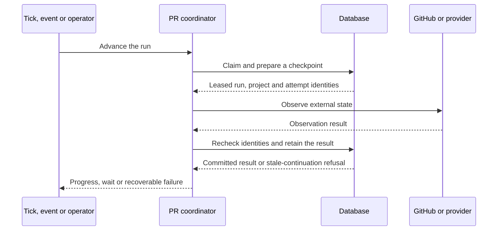

# [ARCH-06-execution] Execution and recovery sequences

## Execution paths

| Path | Durable records | Runtime delegation | Contract owner |
| --- | --- | --- | --- |
| Scheduled task | `ScheduleConfig`, `ScheduleJob` | External trigger claims due work and invokes its registered handler | `CAP-EXEC-scheduling-maintenance` |
| PR delivery | `PipelineRun`, attempts, deliveries and replies | Ticks/events/operator calls enter shared bounded advancement | `CAP-PR-pull-request-delivery` |
| Work Plan | `WorkPlan`, `WorkItem` | Admission creates or attaches a PR, then hands it to the existing PR owner | `CAP-WORK-work-plan-execution` |
| Native SDD | PR activity/request and repository workflow evidence | Isolated evaluation selects a workflow operation; Hub fences its publication and continuation | `CAP-SDD-native-delivery`, `CAP-SDD-workflow-control` |
| SDK task/flow | `sdk_flow_*` releases/runs/steps/attempts/commands | Maintenance advances an immutable admitted release through configured targets | `CAP-SDK-task-flow-execution` |
| Connection diagnostic | Test record, ownership and cleanup evidence | A claimed recipe step prepares, dispatches, observes or cleans up diagnostic work | `CAP-CONN-connection-verification` |

Completing a scheduler invocation does not imply that a delegated PR or SDK flow
has completed. Shared maintenance delegates pending domain work rather than
substituting a second execution owner.

## Ordinary PR observation

The observation transaction ends before external I/O. A later write rechecks the
checkpoint in a fresh transaction. If the result enables another ready step,
advancement can continue within its existing invocation budget. Delivery or an
actual wait returns control to a later trigger. CI interpretation and provider
transport are delegated to `CAP-PR-ci-observation` and `CAP-PR-agent-dispatch`.

Webhook acknowledgement precedes completion of this path. The stored delivery
can be processed through the configured queue or bounded recovery;
`CAP-PR-webhook-advancement` owns that intake/continuation boundary.

## Native decision publication

Native proposal decisions use a different transaction sequence:

1. Retain the request identity and prepare its candidate repository commit.
2. Recheck publication authority and hold the Run/Project fence for the bounded push.
3. Retain the published candidate and apply continuation only if it remains applicable.
4. After an uncertain push/result write, reconcile the exact remote candidate
   rather than repeat publication or restore withdrawn authority.

`CAP-SDD-native-delivery` owns proposal decisions;
`CAP-SDD-workflow-control` owns workflow answers, handoff and integration actions.
`CAP-SDD-runtime-isolation` owns the evaluation process and identity inputs.
The general identity/fencing concepts and deliberate transaction exceptions are
collected in `ARCH-08-crosscutting-concepts`.

## SDK dispatch and PR handoff

Release registration and run admission retain the definition/binding snapshot.
A maintenance step then commits attempt intent, calls the bound worker outside
the database transaction and fences the returned result. Recovery inspects the
same attempt before deciding whether another submission is permitted.

The existing-PR bridge inserts a repository-evidence check and scoped approval
before resuming the existing PR owner. A retained resume receipt lets recovery
follow the same PR attempt. The SDK flow projects that owner's outcome; it does
not replace its ready/CI/merge handling. Exact conditions are in
`CAP-SDK-existing-pr-bridge`.

## Diagnostic completion and housekeeping

A diagnostic step records its verification result separately from resource
cleanup. Shared maintenance can continue unresolved cleanup after the initiating
schedule or page is gone. The diagnostic coordinator and provider recipe remain
responsible for ownership proof and current step identity throughout that work.

Notice delivery reports a retained outcome and has its own acknowledgement;
it does not change the work's authorization. Rate limits, connector rejection
and provider admission holds return control to their owning path's retry/wait
policy. `CAP-NOTIFY-operator-notifications` owns the outbound report, while the
execution capability owns the actual next action.

Implementation anchors include
[PR progress](../../modules/hub/app/features/project_management/pipeline_runs/usecases/progress.py),
[SDD publication](../../modules/hub/app/features/project_management/sdd/plan_publication.py),
[SDK runtime](../../modules/hub/app/features/execution/flows/runtime.py) and
[connection coordination](../../modules/hub/app/features/project_management/connection_tests/services.py).
`ARCH-10-quality-requirements` connects these sequences to measurable regression
scenarios; [deployment status](../operations/deployment-status.md) retains live evidence.
