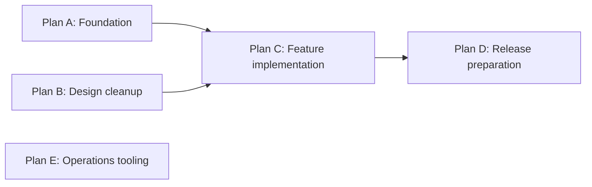

# Work plan and dependency execution design

> 2026-10-01 extension: the pre-execution Draft, Proposed, and archived states and
> comments and activity history follow the [follow-up contract](work-plan-backlog.md).
> The original design's register-to-run and fixed-item contract below applies to
> executable active/paused plans.

Summary of the 2026-09-22 discussion. **This design document records agreements and
initial proposals.** See the [implementation guide](work-plans.md) for the initial
local implementation and the finalized detailed behavior and limits. It is not yet
deployed to production.
It separates behavior agreed in the discussion from proposals to be refined during
implementation.
For the current implementation, refer to [architecture](architecture.md),
[retention policy](operator-notices.md#history-retention), and
[delivery status](delivery-status.md).

## Purpose and agreed usage flow

Users register several tasks and their desired dependencies at once. AutoHub runs
tasks whose dependencies are satisfied in parallel within execution capacity, and
starts dependent tasks automatically after their predecessors merge. Chaining several
plans can also express milestone order.

- Registering a plan is itself the execution request. There is no separate plan
  approval step.
- Implementation and verification proceed as soon as execution conditions are met.
- Merging follows the project policy. The desired default behavior is auto-merge.
- A predecessor task is complete when its PR is merged into the specified target branch.
  An agent reply, finished implementation, or passing CI alone does not release
  dependent tasks.
- Plans and tasks without dependencies can proceed in parallel within the project's
  and AI Catalog's concurrency limits. Waiting on dependencies holds no execution slot.
- Plan pause/revoke controls items that have not started yet.
  Execution that has already started does not need to be stopped in external systems.

## Current structure and added responsibilities

| Unit | Current or proposed responsibility |
| --- | --- |
| `ScheduleJob` — current | State, result, and retries of one scheduler run. Success does not mean the development work is finished. |
| `PipelineRun` — current | Ongoing lifecycle of one PR from registration through implementation, CI, fixes, and merge. Manages pause/resume, failure and cancellation, leases, and recovery. |
| `ExecutionAttempt` — current | An individual implementation, CI fix, or conflict fix request within a run, and its execution state. |
| `WorkPlan` — proposed | Plan specification, plan-to-plan dependencies, control over starting new work, and plan result. |
| `WorkItem` — proposed | Task specification and completion criteria that exist before a PR is created, dependencies within the same plan, execution link, and persistent result. |

```text
WorkPlan
  └─ WorkItem
       └─ PipelineRun
            └─ ExecutionAttempt

Scheduler / ScheduleJob: periodically observes the state above and performs required processing
```

`PipelineRun` currently requires a PR number and a branch. Plans and items manage
execution order and waiting ahead of that, prepare the branch and PR for an executable
item, and then hand it to the existing run pipeline. Items do not reimplement CI
fixes or agent reply handling. Even when a rerun or PR replacement is needed,
dependencies reference stable item IDs. Duplicate active executions of one item are
prevented.

Even when a job that observed a run finishes normally, the run may still be in
implementation. The next job observes the same run again. Adding plans and items
keeps this execution model.

## Dependencies: permanent domain constraints

The following restrictions are not compromises of the initial version but rules
that will remain.

| Relationship | Support |
| --- | --- |
| Plan → Plan | Supported. The dependent plan is released when all predecessor plans complete successfully. |
| Item → Item within the same plan | Supported. The dependent item is released when all predecessor items are merged. |
| Item → Item across different plans | Permanently unsupported. |
| Direct Plan → Item or Item → Plan reference | Unsupported. |

The plan graph and each plan's item graph are each directed acyclic graphs.
Self references, cycles, missing targets, and references to another plan's items
are rejected on registration and edit. The same rules apply not only to UI selection
scope but also to the API and storage integrity.
If only part of another plan's result is needed first, split that part into a
separate plan.



A, B, and E proceed in parallel within capacity. C is released when both A and B
complete, and D when C completes. Within C, items also run according to their
dependencies.

An item can start when all of the following hold.

1. Its plan allows new execution. It is not in a pause/revoke state.
2. All predecessor plans of its plan completed successfully.
3. All predecessor items within the same plan completed successfully.
4. The item is unstarted and does not duplicate an existing execution or start
   reservation.
5. Project and catalog policy and execution capacity allow the start.

Dependency release and actual start are distinct. Work can be executable yet still
wait because of quota or concurrency. A failure of a given predecessor blocks only its
dependents, and independent work continues. Failure, cancellation, and revoke are not
treated as success.

## PR preparation and merge policy

All task specifications are registered up front, but the branch and PR are prepared
when the item actually runs. Work must start from a target branch that includes the
predecessor changes. Record the confirmation that the predecessor PR merged and the
base commit of the dependent execution, so work does not start from a stale branch.

The current Codex execution path requires a PR, so a branch and PR preparation
feature for general tasks is also needed. PR creation and execution requests store
the intent first; after a restart or a lost external response, they find and recover
the existing result to prevent duplicate creation.

The current implementation does not merge a Draft PR until the user marks it Ready,
even with `auto_merge=true`. To avoid requiring separate approval after plan
registration, the link between Draft handling of auto-created PRs and the project
merge policy must be adjusted during implementation.
Under an auto-merge policy, work must be able to proceed through CI verification to
merge without a separate Ready action.
Under a manual merge policy, work waits for the PR merge, and dependent items and
plans wait as well.
If a person switches the PR back to Draft, that same explicit hold signal must not
be ignored.

Tasks without dependencies can still modify the same files. Parallel implementation
does not guarantee conflict-free merges, so keep the existing conflict fixes and the
latest head/base and CI checks right before merge.

## Plan pause / resume / revoke

The agreed scope is **control over new execution of waiting items**. It is not to be
read as stopping runs that have already started or canceling external agent
executions.

The following table is a behavior proposal that refines this scope. In particular,
the irreversibility of revoke and the start boundary are to be finalized together
with API and UI terminology before implementation.

| Action | Unstarted item | Already started item / run |
| --- | --- | --- |
| Pause | Holds new starts. Does not start even if dependencies are released. | Continues observation, implementation, CI fixes, conflict fixes, and merge according to the project policy. |
| Resume | Re-evaluates current dependencies and capacity, then starts. | Does not restart existing runs or resend requests. |
| Revoke | Withdraws remaining execution requests. Leaves unstarted items in a withdrawn state and does not run them automatically. | Continues processing existing runs and records their actual results. Does not undo merges already made. |

Proposed additional rules:

- Pause is a temporary hold released by Resume. Revoke is the final withdrawal of
  remaining work and is not revived by a normal Resume. Work to be done again is
  registered as a new plan.
- Show the plan's execution-allowed state separately from the counts of in-progress,
  successful, failed, and withdrawn items. Even when `revoked`, already started items
  can still be running.
- If all items complete successfully during a pause, the completion can be recorded.
  Pause only blocks new starts. A completed predecessor plan satisfies the condition
  of its dependent plans.
- A revoked plan is not treated as successful. The default proposal is to preserve
  the results of already started items but not release dependent plans automatically.
- Dependent plans are not paused or revoked automatically. They wait while showing
  the unmet predecessor condition. Dependent executions that already started are not
  stopped retroactively.
- Pause/revoke does not apply to completed plans.

### Start boundary and concurrent requests

The proposed start boundary is **the moment the item's execution start is atomically
committed in the DB**. Branch and PR preparation and run linking follow. A simple queue
query or candidate selection is not a start.

Pause/revoke and start commits are serialized on the same plan's control state and
revision. If the control request commits first, even existing queue candidates cannot
start. If the start commits first, the item is treated as already started and can
proceed. The in-progress count includes this preparation stage so users can see the
boundary.
A start for which it is uncertain whether the external request was sent is not reset
to unstarted with a new request sent; instead, the existing execution is looked up
and recovered.

## Completion results and history retention

### Current policy

| Target | Current retention policy |
| --- | --- |
| Successful ScheduleJob | 3 days after finishing |
| Failed ScheduleJob | 7 days after finishing. Retryable jobs are preserved |
| `completed`, `failed`, `canceled` PipelineRun | 30 days after the last change |
| In-progress, `paused`, `blocked` PipelineRun | Not deleted automatically |
| Run with a valid lease | Excluded from deletion |

Cleanup runs at most once per hour, up to 200 runs and 1,000 jobs. A run's attempts,
deliveries, and replies are deleted with it. This policy does not delete GitHub PRs
or branches.
Jules sessions keep a run-expiry marker and the PR URL and report to prevent
re-registering the same PR.

### Proposals for plans and items

**Do not treat a missing run as success.** Failed and canceled runs are already
deleted today, so absence cannot be evidence of success. Dependency decisions use the
explicit success results preserved on items and plans, not the existence of a run.

Items record at least the result, completion time, repository and PR identifiers and
URL, target branch, merge commit, and execution identifier. The result must stay
readable after the run details expire.
A plan records its completion after confirming the success results of all its items.

- Successful runs can follow the existing 30-day retention policy after the item
  result is safely recorded.
- Failed runs needed to recover or investigate unresolved items are excluded from
  automatic deletion. The approach is to apply the retention period after the item is
  resolved by retry or the work is explicitly closed. The retention start point must
  also be defined so runs are not deleted immediately just because they are already
  old before resolution.
- Protection for in-progress, paused, and blocked runs and valid leases is kept.
- Canceled and withdrawn results are also recorded explicitly. Cleanup does not turn
  them into success.
- The first version does not automatically delete plan and item specifications,
  dependencies, or final results. Even after run history expires, whether predecessor
  plans and items succeeded can still be determined.
- Recording run results and deletion must not race. Either record the result in the
  same transaction, or select for cleanup only runs whose result recording is
  confirmed.
- Normal expiry is marked separately, and a linked run that disappeared without a
  success result is put into a needs-review state. Dependent execution is held and
  recovered from actual merge evidence on GitHub.

Retention decisions check not only elapsed time but also **whether the result used for
dependency decisions is preserved, and whether execution details are needed to recover
unresolved work**.
Standalone runs and existing Jules expiry handling remain compatible.

## GitHub Issue: record sync separate from execution

Additional agreement: GitHub Issues are a copy for viewing specifications and task
processing history in the repository. AutoHub is the source of truth for execution
state, dependencies, and success. The PR's actual code, CI, and merge state are used
for execution decisions as before, but issue bodies, comments, closing, reopening,
and relationships are not.

- A plan is recorded as a parent issue and an item as a sub-issue, with PR links and
  key state history.
- Dependencies are for display. Editing relationships on GitHub does not change
  AutoHub execution.
- Sync is one-way from AutoHub to GitHub; GitHub edits are not imported as
  specifications or used as execution triggers.
- Issue create/update failures and API limits are retried from a sync queue. They do
  not block task execution.
- The automatic creation intent and identifiers are preserved to prevent duplicate
  issues after a lost response.
- Key state changes are recorded instead of every polling pass. Issues show a notice
  that they are for record keeping.
- Usable on free private repositories as well. REST request and content-creation rate
  limits and the limit of 100 sub-issues per parent are accounted for in the
  implementation.

## Input, change, and UI proposals

- Plans and item lists and dependencies are validated together and then registered
  atomically. No part of an invalid plan runs first.
- Item dependency targets can only be selected within the same plan.
- Show predecessor plan wait, predecessor item wait, capacity wait, plan pause,
  approval/manual merge wait, failure needing review, and withdrawal as distinct states.
- Plan details show item relationships and progress, and execution details navigate
  to runs and attempts. Completion results and PR links remain visible after the run
  expires.
- Specification and relationship changes to work that has not started are revalidated.
  Work that has already started does not get new predecessor conditions that would
  retroactively change its execution conditions.
- Completed plans are frozen. Additional work is registered as a new plan so the
  premises of already released dependent plans are not overturned.

## Decisions remaining before implementation

- The proposal is to limit the first scope to plans in one project/repository.
  Whether plans in different projects can depend on each other is not yet agreed.
  Even if allowed, the ban on item dependencies across different plans does not change.
- The default target branch, the PR preparation method, and the concrete link between
  the project merge policy and Draft handling.
- The pause/revoke start boundary, how to re-request after revoke, and detailed UX for
  completion decisions.
- Conditions for lifting protection of failed runs and the retention start point, and
  how run-expiry markers link to item execution history.
- Whether empty plans are allowed, the scope of adding and removing items in an
  in-progress plan, and retry and PR replacement APIs.

Automatic task decomposition/WBS generation, an arbitrary pipeline language, and
running predecessors on top of unmerged parent branches are out of scope for this
design. The first step is a structure that executes explicit plans, items, and
dependencies.

## Implementation verification criteria

1. Plans and items without dependencies run in parallel within capacity, and work
   with several parents is released only when all of them succeed.
2. References to another plan's items, self references, and cycles are rejected on
   both registration and edit.
3. Passing predecessor CI alone does not release dependents; dependent work starts from
   a base that includes the merge result.
4. A failure of one task does not block independent tasks, and failure, cancellation,
   and withdrawal do not satisfy a dependent's success condition.
5. Races between pause/revoke and start commits, Resume, and restarts during preparation
   produce no duplicate PRs or executions.
6. After pause/revoke, existing runs continue observation, fixes, and merge, and only
   new execution of waiting items is controlled.
7. Dependency decisions stay the same after successful runs are deleted, and unresolved
   failed, paused, and blocked runs are protected.
8. Concurrent result recording and cleanup do not lose success evidence, and a run
   missing for an unknown reason is not success.
9. A manual merge policy waits for the merge, and an auto-merge policy proceeds without
   separate plan approval.
10. Existing standalone PR execution, catalog capacity management, and prevention of
    re-registration after Jules session expiry are preserved.
