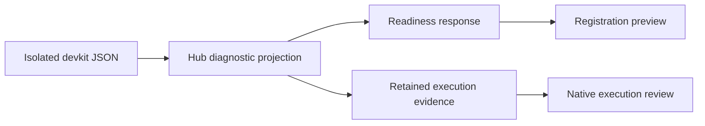

# Technical Plan: `SPEC-sdd-diagnostics-readiness`

## 1. Constitution & Invariant Review

No invariant change or ADR is required. Preserve `CAP-SDD-runtime-isolation` sanitized-output boundaries and `CAP-SDD-workflow-control` registration, hold and approval authority. Guidance is data, never permission to retry or execute a command.

## 2. Architecture Overview & Impact

The backend projects upstream JSON notices/errors through a Hub-owned diagnostic catalog. Readiness exposes additive diagnostics and effective policy; retained execution evidence preserves the same diagnostic shape. The existing repository registration panel previews workflow context and shares a diagnostic renderer with native execution review. No package dependency or database migration is required.

## 3. Component & Interface Design

The additive diagnostic record contains `code`, `severity` (`error`, `warning`, `info`), `category` (`repository`, `runtime`, `decision`), `message`, `action`, `retry` (`after_fix`, `safe`, `never`) and `target_files`. Every displayed field comes from Hub-owned mappings; upstream free text is not copied. Unknown diagnostics use generic static guidance. Collections are bounded and deduplicated.

`SddReadiness` adds `diagnostics` and `policy`; retained run evidence adds `diagnostics`. Existing `warnings` and `ready` behavior remain compatible. Strip notice payloads from semantic policy snapshots before identity comparison while retaining the projected diagnostic separately. Approval requests and existing worker holds use existing validated workflow evidence.

Frontend components separate readiness state from presentational preview. The preview describes the next observed stage and wait conditions without answering, approving or automatically starting work. Diagnostics use one renderer with historical-warning fallback. Regenerate the typed UI API after backend models change.

## 4. Storage & State Management

Persist diagnostics within existing JSON execution evidence. No schema migration is required. Keep successful inspection keyed to project/unit/PR and discard late results for an old key. Do not alter decision receipts, evidence fences or retry counters.

## 5. Error Handling & Edge Cases

Known upstream codes select bounded static guidance. Unknown or malformed diagnostic content is generic. A failed evaluation retains safe diagnostics in readiness and blocked run evidence. Existing warnings continue to render for historical records. Notice-only changes must not invalidate an admitted policy snapshot.

## 6. Verification & Test Plan

- Backend projection/evaluation/readiness tests cover AC-01–AC-03, including hostile free text, unknown notices, failure preservation and identity stability.
- Frontend integration tests cover AC-04–AC-06: initial waits, approval context, selection invalidation, late responses and legacy warnings.
- Run `just gen-ui-api`, `just check-ui-api`, relevant backend/UI tests, `just lint` and `just check`.
- Inspect the final diff against the owning CAP/UC/UX documents; run document rules and `git diff --check`. Record actual executed checks separately from source inspection.
