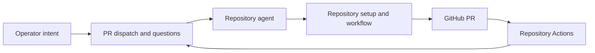

# Technical Plan: `SPEC-optimistic-sdd-orchestration`

## 1. Constitution & Invariant Review

`ADR-repository-owned-sdd-execution` replaces the runtime, path-source,
offline-source-build and native-batch decisions. Their current contracts are
reconciled before integration; Auto Hub contributor SDD and generic SDK remain.
The user approved removal of live native batches and both built-in SDK bridges.
Independent UX review requested by the user ran against the draft panels;
its owner-conflict, unknown-result and interface-link findings are resolved.

## 2. Architecture Overview & Impact

Use ordinary PR progression for new SDD activities. No new package or service.
Retain descriptive `sdd_snapshot` with `execution_version: 2`,
`provider: repository-agent`, `spec_dir`, activity/handoff intent and optional
effort. Legacy snapshots without version 2 are read-only; they never select live
native progression. Activity claims use the same version discriminator in their
checkpoint. Shared helper predicates prevent truthiness-based routing.

Preserve GitHub activity ownership/checkpoints while replacing local Git branch
commits with a GitHub Git API empty intent commit using the unchanged base tree, ref creation and Draft PR creation. The distinct intent commit permits a PR without editing repository files. The worker receives the
repository instructions and requested intent, without stage or sync commands.
Keep question correlation and current-head CI; ingest optimistic questions before
push-based progression, including while observing CI, and recheck pending input
at the merge fence.

Retain historical batch models, repository reads and decision receipts. Remove
all executable graph/runtime/controller modules and SDD batch maintenance. Retire
both built-in bridge namespaces at registration/admission and durably settle
unreceipted old work. Receipt-backed bridge deliveries observe the old owner only.

## 3. Component & Interface Design

- New Runs: ordinary enrollment plus optional descriptive SDD unit intent. No
  status/size/receipt/lock evaluation. Existing branch/path shape guards remain.
- `StartActivityRequest`: existing request UUID, base, catalog and effort fields.
  Starts are idempotent and always Draft. The claim's exact saved artifacts guard
  response-loss recovery; a different owner remains a conflict.
- Runtime/readiness/milestone evaluation and native typed decisions are retired.
  Old native mutations return HTTP 410 `SDD_EXECUTION_RETIRED`; history GETs remain.
- Batch create/resume is retired; history and local Stop settlement remain.
- Legacy bridge registration/start/control new effects return HTTP 410
  `SDD_BRIDGE_RETIRED`. Async unreceipted attempts settle failed, not retryable.
- Legacy claim reconciliation is explicit, project-scoped and bound to the exact
  retained checkpoint digest and actor acknowledgment of inspected external work.
  It releases only the selected reservation, never resumes a Run or creates work.

## 4. Storage & State Management

Use a frozen data migration after `b582df39e211`; add no destructive schema drop.
Cancel nonterminal legacy native Runs, revoke leases and settle mutable local
attempt state. Stop old batches while retaining selections and outcomes. Fence
legacy claims and retain uncertainty/reservations until explicit reconciliation.
Delete rebuildable actionable native decision projections, retaining owner
receipts. A downgrade does not reactivate anything. New snapshots/claims carry
version 2 and follow ordinary PR locks and immutable attempt identity.

## 5. Error Handling & Edge Cases

Unknown GitHub publication retains the exact original intent and request ID;
recovery inspects the saved candidate, never fabricates a replacement. Wrong
project/ref/catalog/owner still refuses. Retired mutation refusals occur before
repository execution or remote writes. Completed legacy records stay unchanged.
External agents cannot be canceled by local retirement; operators inspect them
before acknowledging ownership release. A question/answer is never merge authority.

## 6. Verification & Test Plan

Run focused optimistic launch/recovery, question/push/CI, retired mutation and
historical-read tests; migration upgrade/downgrade and PostgreSQL claim races;
SDK bridge retirement plus generic flows; frontend integration tests for absent
probes/controls, preserved unknown intent and history. Then `just lint`, `just
check`, `just docs-check`, `just gen-ui-api` and `just check-ui-api`. Run standalone
SDK tests/build if its code changes. No live provider/GitHub result is claimed.

## Approved Responsibility and Retirement Details

#### Responsibility boundary

- Start intent is explicit: project, base branch, proposal/spec path, Planning or
  Development and optional catalog/effort. This is a work request, not proof that
  the repository is eligible for the requested phase.
- Hub validates authorization, enabled project/connector/catalog, input shape,
  live GitHub refs and exclusive ownership. It does not validate SDD adoption,
  proposal status, size, prerequisites, receipt freshness, lock or bundle content.
- Hub creates an activity branch and a Draft PR using GitHub APIs. It does not
  check out the repository or make a proposal-status edit. Existing exact
  request/branch/PR ownership guards remain necessary for response-loss recovery.
- The agent follows the repository's instructions until its work is finished or
  needs operator input. Hub does not name the next devkit stage, tell it to run
  `sync`, prescribe repository setup, or author acceptance/handoff/answer records.
- Reuse the existing implementation request, PR push observation and
  `RunQuestion`/`RunAnswer`/explicit resume. No replacement worker-result API,
  SDD report signature, workflow JSON interpreter or remote evaluator is added.
- Both Planning and Development launches stay Draft until the operator marks the
  PR ready. The agent is instructed to leave ready/merge to the operator and Hub.
  Once ready, existing project auto-merge policy and current-head GitHub CI apply.
  Repository-internal gates remain the repository/agent's responsibility; Hub
  does not claim to enforce them. Pushes or generic answers do not mark PRs ready.
- Preserve question ingestion around pushes: an observed current-attempt question
  pauses the Run before CI/merge progression, including a question posted after a
  push while the PR is Draft. Reuse correlation/head fences; do not reintroduce
  repository workflow evaluation to decide whether the question is valid.

#### Removal inventory

| Area | Remove | Retain or simplify |
| --- | --- | --- |
| Runtime | `lock_runtime.py`, `runtime_cache.py`, `runtime_install.py`, `runtime.py`, SDD OS isolation, runtime probes and install diagnostics | No replacement evaluator environment, local checkout or source-token access for evaluation |
| Evaluator | `services.py` workflow evaluation; `policy.py` adoption/size/stage checks; runtime/workflow/configuration evidence hashing; envelope interpretation | Optional unit path and activity intent as descriptive execution metadata |
| Stage control | `progress.py` stage selection/redispatch; server acceptance/rejection/handoff/return/answer publication; `decisions.py`, `plan_decisions.py`, `plan_publication.py`, `answer_publication.py`, `gates.py` and evaluator-only report projections | Ordinary PR controls, correlated agent questions and explicitly selected answers; legacy decision history remains read-only |
| Discovery | Native workflow decision generation and readiness-derived actions | Generic Run questions and existing non-SDD decision owners; retained native evidence is historical |
| Milestones and batches | Executable milestone preview, graph/eligibility analysis, batch creation/resume/admission and SDD batch maintenance | Repository document browsing and historical batch/claim reads; Stop can settle an old local owner without starting new work |
| SDK bridge | Both evaluator-coupled `autohub.sdd:*` and `autohub.pr_delivery:*` built-in bindings, checkout/evidence configuration and bridge dispatch | Generic SDK tasks/flows/approvals and ordinary scoped PR resume APIs; no replacement built-in bridge |
| Public surfaces | Runtime/readiness/milestone-evaluation endpoints; native typed workflow mutation APIs; batch execution mutations and matching MCP tools | Single-activity starts, run links, ordinary questions/controls and historical reads |
| Packaging and tests | `config/sdd-runtime`, `config/sdd-build`, installer and SDD test scripts/recipes, SDD image stages/env/cache/bubblewrap, evaluator-only CI job and source credential requirement | Auto Hub contributor devkit dependencies, `just init hub`, normal backend/UI/SDK checks and normal GitHub CI observation |

`CAP-SDD-native-delivery` becomes optimistic activity dispatch.
`CAP-SDD-workflow-control` and `CAP-SDD-runtime-isolation` cease to promise live
workflow/runtime evaluation. `CAP-SDK-existing-pr-bridge` is retired with its
built-in bindings. Historical records and IDs remain readable; no evaluator
fallback is kept for them. Delete evaluator-only tests and replace them with
regressions for the new boundary and retained orchestration.

#### Scope Excluded

- Creating a GitHub Action, remote devkit runner or check-result ingestion protocol.
- Delegating `devkit sync` to a runner or Action as a substitute for its removal.
- Reimplementing devkit rules, workflow gates or dependency resolution in Hub.
- Replacing native milestone batches with a new operator-authored queue system.
- Changing generic SDK runtime isolation, ordinary CI verification semantics,
  provider adapters, Work Plans or Auto Hub's own SDD contributor process.
- Deleting historical runs, attempts, batch selections, decisions or PR links.

#### Historical and in-flight work

The cutover stops new legacy-native admission before changing its dispatch path.
A data migration marks every nonterminal old native Run canceled with an explicit
retirement reason, invalidates its lease and settles local active attempts.
It stops legacy batches, fences their claims and retains exact saved remote
artifacts and uncertainty. It does not issue GitHub writes or pretend to cancel
provider work. Terminal history is unchanged. A new optimistic Run uses an
explicit execution-version discriminator, not truthiness of `sdd_snapshot`.

Old native resume/approval and old batch create/resume are refused with HTTP 410
`SDD_EXECUTION_RETIRED`. Synchronous legacy bridge registration/start/control
boundaries refuse new effects with HTTP 410 `SDD_BRIDGE_RETIRED`. Undispatched
legacy bridge steps are durably retired before claiming. Outstanding attempts
without a saved resume receipt settle with a terminal failed `WorkerResult`
carrying `SDD_BRIDGE_RETIRED`, rather than entering transient-unavailable retry.
Receipt-backed deliveries retain observe-only progression of their existing PR
owner and never repeat resume. Refusal performs no checkout, CLI or remote
mutation. An undelivered legacy bridge claim cannot create a new effect.
Migration preserves completed flow results.

History reads retain old snapshots and immutable attempt requests. No generic
resume implicitly converts an old Run. Starting another Run for the same PR
requires an explicit reconciliation acknowledgment after inspecting any
previously dispatched work; uncertain old activity claims keep their ownership
reservation until that acknowledgment records the exact candidate. Operator
rollout guidance covers external agents still working after local cancellation.
A downgrade never reactivates a retired Run, batch or claim.

#### Related open proposal disposition

The user authorized rejection of related open proposals. Inventory covers the
six other proposal anchors returned by `docs list proposal --all-namespaces
-n 0`; target blueprints are not additional work requests.

- `PROP-run-origin-links` stays accepted: Work Item/Work Plan/provider-session
  origins remain useful. Its native SDD unit/batch links target read-only retained
  subjects after this cutover; readiness and batch-control behavior is removed
  from its future contract. Historical origin links need no runtime.
- `PROP-updated-at-maintenance` stays accepted: timestamp correctness is
  independent of repository validation. Its SDD batch examples apply only to
  retained owner writes that still exist; deleted execution paths add no work.
- `PROP-schedule-config-ownership`, `PROP-jules-antigravity-migration`,
  `PROP-owed-counts-error-reason` and `PROP-sidebar-overflow-cues` are independent.

No open proposal has embedded SDD evaluation as its sole outcome, so none is
rejected wholesale. The removed design is implemented history in completed specs
and accepted ADRs. The preliminary decision identifies the ADRs to supersede.
Development rechecks the inventory and aligns surviving partial proposals under
exclusive ownership before they are used for a later handoff. If another live
branch owns one, coordinate that change rather than rewriting it from this task.
