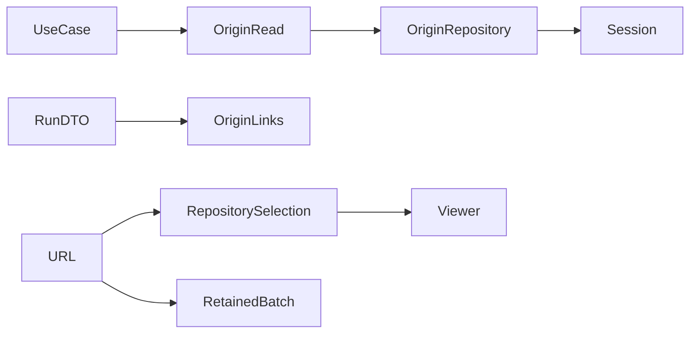

# Technical Plan: Run origin links and subject deep links

## 1. Constitution & Invariant Review

No accepted invariant changes. `ADR-repository-owned-sdd-execution` retains repository execution ownership and historical batch inspection. Reuse the existing project-management to AI-catalog dependency. No new feature edge, schema, session factory or execution authority is introduced.

## 2. Architecture Overview & Impact

A repository bulk-loads reverse relationships for selected runs; a read projector converts them into additive PipelineRunRead fields. Use cases call the same projector before returning run DTOs. UI link/presentation helpers consume that DTO. Repository selection state validates URL subject/ref and fences async reads; retained batch state owns its separate exact detail/list cache.

## 3. Component & Interface Design

PipelineRunRead adds enrollment_source plus related_origins. Each origin has kind, id and relevant work_plan_id, catalog_id, unit, batch_id or url. All references derive from retained rows; UI labels the category Related origin. A nonempty sdd_snapshot contributes native_sdd evidence independently of reverse claims.

The projector takes caller session and selected run rows. It runs one WorkItem/WorkPlan join, one Provider session query and one SDD claim/member/batch join. It groups by run ID, checks project identity for owners, deduplicates and sorts by kind/ID. A single-row helper uses the same path for mutations and detail.

Unit syntax matches backend EnrollPullRequest's proposal/spec directory contract. Addressed ref is visible and used for existence reads and viewer data. Validate the unit's spec.md or proposal.md via repository blob read before passing it to execution selection. A sequence token invalidates earlier info/tree/blob/address results. Browse clears only the failed selection and resets an unavailable addressed ref to default.

## 4. Storage & State Management

No database change. URL query is the selection request. Viewer mode can change without clearing it. Batch state separates requested ID, selected detail, cached list and errors; only project changes reset list cache. Exact detail is merged into list options. No old detail survives as a substitute for failed current address.

## 5. Error Handling & Edge Cases

A projection failure propagates normally. Invalid unit/UUID, missing branch/subject and non-SDD selections show unavailable state; transient errors add Retry. No session URL means plain text. No unit selection is inferred from a batch. Every request checks its project/address sequence before assigning state.

## 6. Verification & Test Plan

Backend regression tests cover relationships, unknown/multiple, project isolation, pagination, one connection and three additional SELECTs on SQLite/PostgreSQL. UI tests cover links/recovery without scans, branch/unit validation, route changes, stale responses, old batches/list cache, simultaneous subjects and no mutations. Run just gen-ui-api and just check-ui-api after API additions. Run focused tests, just lint, just check, full backend coverage and document rules. Independent code review and separate reconciliation review are required at medium effort.
